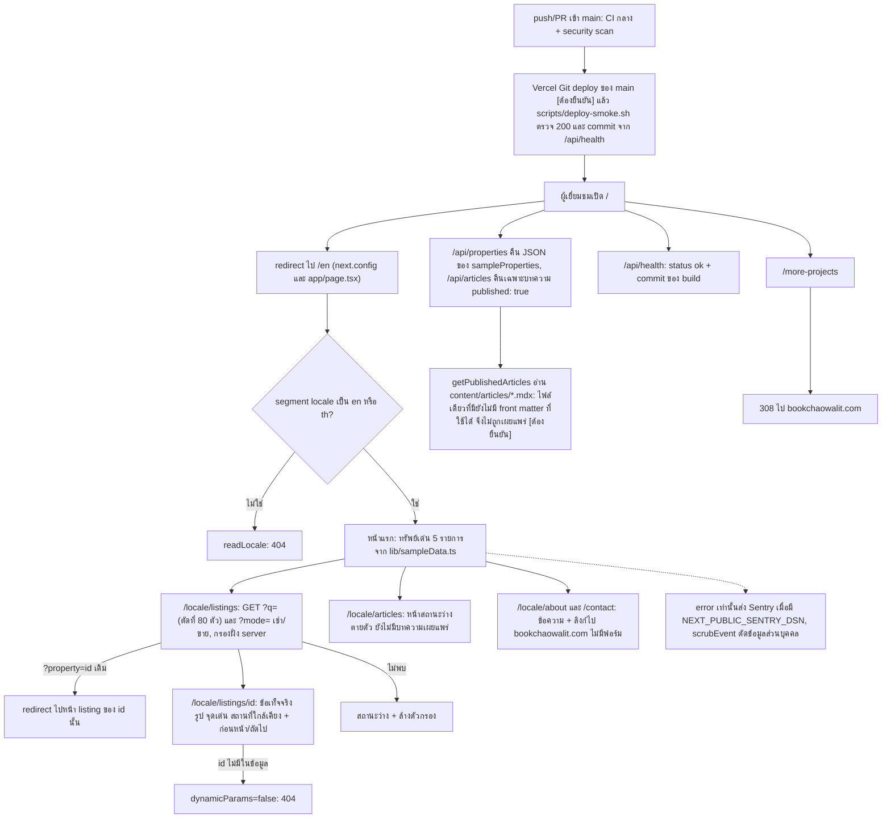
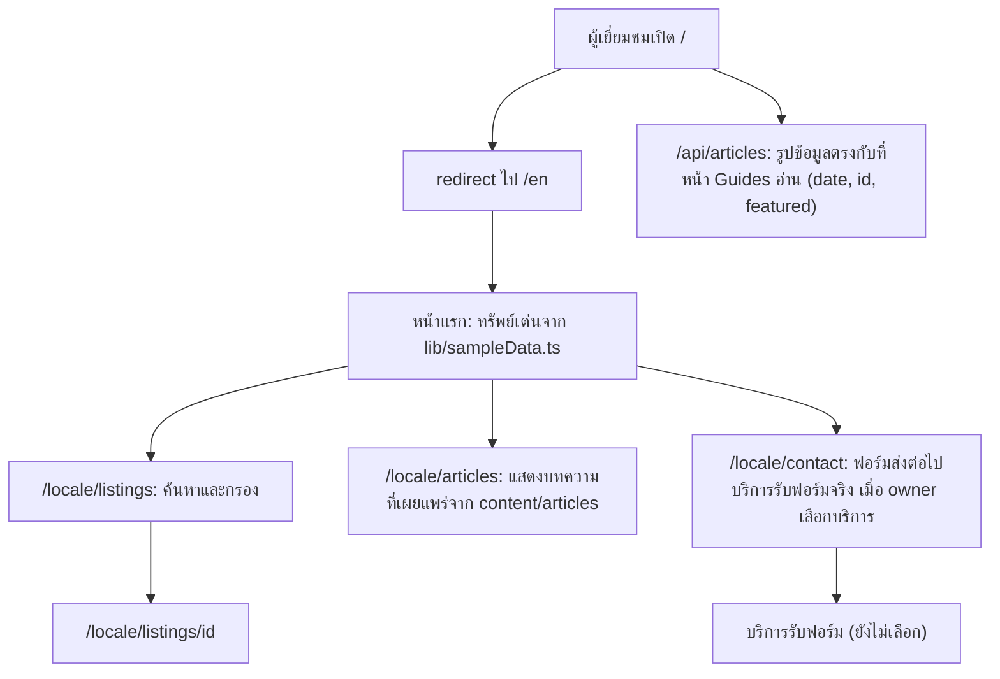

# 01 — Business process (As-Is / To-Be)

sales-agencyrenting-web (Agency Renting) คือเดโมโต๊ะค้นหาทรัพย์สองภาษา (EN/TH) สำหรับผู้เยี่ยมชมที่เทียบบ้านในไทย ใช้ listing ตัวอย่างที่เขียนไว้ในโค้ด ค้นหาด้วย GET query และกรองเช่า/ขาย ไม่มีนายหน้า คลังทรัพย์จริง CRM หรือฟอร์มส่งข้อความ หน้า Contact เป็นลิงก์ไปเว็บหลักเท่านั้น

Last reviewed: 2026-11-28 · commit `1e9d9b3`

## As-Is (จากโค้ดวันนี้)

Sources: `app/page.tsx`, `next.config.ts`, `app/[locale]/page.tsx`, `app/[locale]/listings/page.tsx`, `app/[locale]/listings/[id]/page.tsx`, `app/[locale]/articles/page.tsx`, `app/[locale]/contact/page.tsx`, `components/agency-views.tsx`, `lib/sampleData.ts`, `lib/locale-page.ts`, `lib/articles.ts`, `app/api/properties/route.ts`, `app/api/articles/route.ts`, `app/api/health/route.ts`, `scripts/deploy-smoke.sh`, `lib/sentry.ts`, `PRODUCT.md`

## To-Be (docs/UPGRADE-PLAN.md backlog)

Sources: `docs/UPGRADE-PLAN.md` (P0 บทความ .mdx และรูปข้อมูล API, P1 contact form handoff). แผนนี้เขียนเมื่อ 2026-10 และบางข้อไม่ตรงโค้ดปัจจุบันแล้ว (ดู Open questions)

## Gap

| ID | As-Is → To-Be | Status | Owner | Evidence |
|---|---|---|---|---|
| G1 | ไม่มีบทความเผยแพร่ ไฟล์ .mdx เดียวเสียรูป และหน้า Guides เป็นหน้าว่างตายตัว → แยกเป็น 3 บทความที่เผยแพร่ได้และให้หน้า Guides/`/api/articles` ใช้รูปข้อมูลเดียวกัน | decide | owner | `docs/UPGRADE-PLAN.md` P0 (ต้องให้ owner อนุมัติเนื้อหา); `content/articles/bangkok-real-estate-guide.mdx` |
| G2 | หน้า Contact ไม่มีฟอร์ม มีแต่ลิงก์ไปเว็บหลัก → ฟอร์มที่ส่งต่อไปบริการรับฟอร์มจริง | decide | owner | `docs/UPGRADE-PLAN.md` P1 (รอ owner เลือกบริการ); `PRODUCT.md` ห้ามอ้างว่ามี handoff |

## Open questions

- `docs/UPGRADE-PLAN.md` บางข้อล้าหลังโค้ด: P0 บอกว่า "articles page อ่าน publishedAt/featured/id" แต่โค้ดตอนนี้หน้า Guides เป็นหน้าว่างตายตัวและไม่อ่านบทความเลย; P1 เรื่อง `<html lang>` ต่อ locale และ `next/image` ยังไม่ได้ตรวจในรอบนี้ [ต้องยืนยัน]
- `PRODUCT.md` ยังอ้างถึง `components/PropertySearch.tsx`, `PropertyCard.tsx` ฟอร์มติดต่อจำลอง และโปรไฟล์ agent ที่ไม่มีในโค้ดแล้ว (เปลี่ยนเป็น Reader shell เมื่อ 2026-11-19): เอกสารล้าหลังโค้ด
- สถานะ deploy จริงของ Vercel (`PRODUCT.md` เคยระบุว่าโปรเจกต์ผูกกับชื่อ repo เดิม) ยืนยันจากโค้ดไม่ได้ [ต้องยืนยัน]
